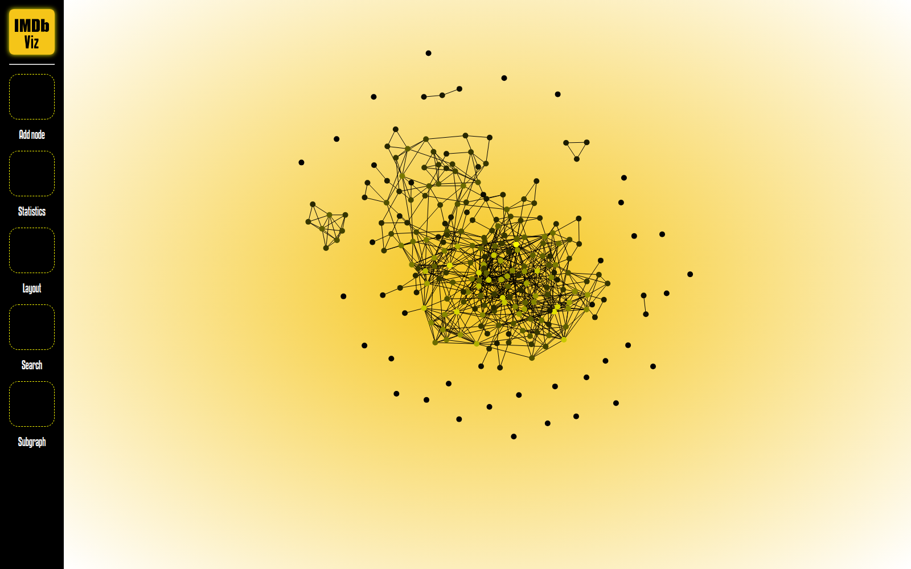

# IMDb Graph Visualization

An interactive D3 network of the IMDb Top 250. Each movie is a node, and two movies are linked when they share a cast member, giving 250 nodes and 662 edges.



## Features

- **Force and radial layouts.** Switch between a force-directed layout and a two-ring radial layout that separates connected movies from isolated ones.
- **Movie details.** Hover a node for a panel with its poster, rank, rating, year, genre, runtime, director, writers and cast. Drag nodes to rearrange the graph.
- **Edit the graph.** Click two movies to connect them with a new edge.
- **Graph statistics.** Average node degree, number of connected components, density and diameter, computed in `GraphClass.js` with BFS and DFS.
- **Largest component.** Toggle a view of only the largest connected component.
- **Search and add.** Find a movie by IMDb ID, or add a new node to the graph.

## Running it

```bash
npm install
npm start      # serves the app at http://localhost:3000
npm test       # mocha tests for the graph algorithms
```

## Built with

D3.js v7, Express and Mocha/Chai.

Built for CSC 343 (Human-Computer Interaction) at the University of Arizona, Fall 2023. The assignment scaffold was provided by the course staff, Stephen Kobourov and Haris Riaz.
